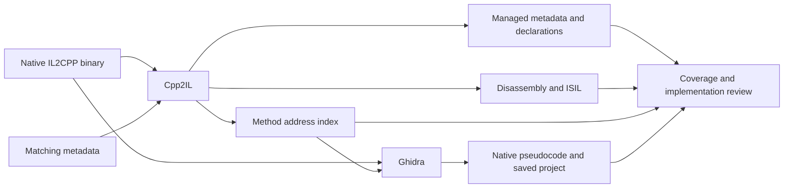

# IL2CPP decompilation from scratch

A practical workflow for turning an installed Unity IL2CPP game into a searchable reverse engineering workspace. PC Building Simulator 2 (PCBS2) is the worked example. The intended next use is multiplayer mod development.

This guide records the work performed on October 24, 2026, including the parts still running. Commands use Windows PowerShell. Adapt the executable name, data directory, architecture, and tool versions for another game.

## 1. Understand the recovery target

Unity's IL2CPP build pipeline compiles C# to managed assemblies, strips code, converts the retained IL to C++, and compiles that into native code. The installed game usually contains the native result and metadata, rather than the original managed implementations. See [Unity's IL2CPP introduction](https://docs.unity.com/en-us/engine/6000.6/manual/programming-environment/scripting-backends/il2cpp/il2cpp-introduction).

Work with three complementary views:

| View | What it provides | Practical limit |
| --- | --- | --- |
| Reconstructed managed metadata | Assemblies, types, inheritance, fields, signatures, tokens, offsets, and method addresses | Generated bodies may be placeholders |
| Native instructions and intermediate instructions | Instructions implementing retained methods, including calls and constants | Intermediate translation may be incomplete for individual instructions |
| Native pseudocode | A higher-level reconstruction of function control flow | Types, local names, and function boundaries can require correction |

Keep these views linked. A folder of reconstructed `Assembly-CSharp.dll` files with empty methods is a metadata export; it does not establish that implementations were recovered.



Decompilation also does not recreate the original Unity editor project. Scenes, prefabs, textures, audio, shaders, and serialized object data require a separate asset workflow. This run inventories those files and concentrates recovery on retained IL2CPP code.

**Completion criterion:** define which code, metadata, assets, and dependencies the run will recover before describing it as complete.

## 2. Inspect the repository and find the game

Read applicable repository instructions and inspect existing files before creating a workflow. Check Git status so unrelated work remains identifiable.

```powershell
Get-Location
rg --files -g AGENTS.md -g '*README*' -g '.gitignore'
git status --short
Get-ChildItem -Force
Get-Command dotnet, java, ilspycmd -ErrorAction SilentlyContinue
```

Find the installation using launcher manifests or known library locations. Epic manifests commonly contain `DisplayName`, `InstallLocation`, and `LaunchExecutable`; Steam library descriptors point to additional libraries. Inspect those sources before recursively searching entire drives.

For this run, the game was found at `<GameDir>`. Its relevant files were:

```text
PCBS2.exe
GameAssembly.dll
UnityPlayer.dll
PCBS2_Data/
  globalgamemanagers
  boot.config
  ScriptingAssemblies.json
  RuntimeInitializeOnLoads.json
  il2cpp_data/Metadata/global-metadata.dat
  Plugins/x86_64/
  StreamingAssets/
```

The presence of `GameAssembly.dll` and `global-metadata.dat` identified the IL2CPP route. A Mono game with managed implementation assemblies needs a different starting workflow. ILSpy and dnSpy can inspect managed assemblies; the native `GameAssembly.dll` requires a native analysis tool for its implementations.

On other platforms, the native IL2CPP binary can instead be a library such as `libil2cpp.so`. Locate the binary/metadata pair for that platform and confirm its architecture independently.

**Completion criterion:** identify the installation, scripting backend, native binary, metadata file, and target architecture.

## 3. Preserve the build and create an ignored workspace

Keep proprietary inputs and generated code in a Git-ignored directory. Keep reusable scripts and general documentation outside it.

This repository uses the user-requested spelling `artiffacts`:

```gitignore
/artiffacts/
/artifacts/
```

Create the output layout before running tools:

```powershell
$gamePath = $env:PCBS2_GAME_DIR
$outputRoot = Join-Path (Get-Location) 'artiffacts\decompiled'
$directories = @('input', 'logs', 'tools', 'metadata', 'native', 'indexes', 'ghidra')
foreach ($directory in $directories) {
    New-Item -ItemType Directory -Path (Join-Path $outputRoot $directory) -Force | Out-Null
}
```

Preserve copies of the native binary and metadata together. Also retain build identifiers and runtime descriptors, including `boot.config`, `ScriptingAssemblies.json`, `RuntimeInitializeOnLoads.json`, `app.info`, and any shipped build-date files.

Record SHA-256 hashes, file sizes, source paths, tool versions, and tool hashes. Inventory the shipped files and native dependencies. User saves and exported player creations are separate from the shipped-code inventory.

```powershell
Get-FileHash -LiteralPath (Join-Path $gamePath 'GameAssembly.dll') -Algorithm SHA256
Get-FileHash -LiteralPath (Join-Path $gamePath 'PCBS2_Data\il2cpp_data\Metadata\global-metadata.dat') -Algorithm SHA256
git check-ignore -v artiffacts/decompiled/input/GameAssembly.dll
```

Use a fresh output directory after a game update. Addresses, offsets, and analysis databases belong to the input hashes that produced them. The [runner](tools/decompile/Invoke-Decompile.ps1) rejects changed inputs when reusing an existing Ghidra project.

**Completion criterion:** preserved matching inputs have hashes, and Git confirms the output is ignored.

## 4. Determine Unity and metadata versions

Check available player version information and serialized-file headers. In this PCBS2 build, the beginning of `globalgamemanagers` contains `6000.2.6f2`.

```powershell
Get-Content -LiteralPath (Join-Path $gamePath 'PCBS2_Data\globalgamemanagers') -Encoding Byte -TotalCount 128 | Format-Hex
Get-Content -LiteralPath (Join-Path $gamePath 'PCBS2_Data\il2cpp_data\Metadata\global-metadata.dat') -Encoding Byte -TotalCount 16 | Format-Hex
```

The metadata starts with bytes `AF 1B B1 FA`, the little-endian representation of magic `0xFAB11BAF`. Its next 32-bit value is the file-header metadata version. This build's header says `31`; Cpp2IL identifies its actual layout as `31.1`.

Preserve both observations. A header number alone can be insufficient to select a parser layout. The offset of a Unity version string in one serialized file is also not a universal location to hard-code for every game.

If the expected metadata cannot be parsed, first check the input pair, file completeness, detected layout, and tool support. Preserve the diagnostic rather than forcing an unrelated version just to obtain output.

**Completion criterion:** record the Unity version and the parser's detected metadata layout, with the original header retained as evidence.

## 5. Choose and pin the tools

These were the tools used or evaluated for this run:

| Tool | Role in this run | Version/result |
| --- | --- | --- |
| [Cpp2IL](https://github.com/SamboyCoding/Cpp2IL) | Metadata assemblies, structural C#, native disassembly, and ISIL | `2022.1.0-pre-release.21`, commit `58fc404ac503f4e512055cafc48c03088fc6e224` |
| [Ghidra](https://github.com/NationalSecurityAgency/ghidra) | Native analysis, persistent project, pseudocode, and direct-call edges | `12.0.1` |
| Java JDK | Run Ghidra and compile its Java scripts | Java 21, matching this Ghidra installation's requirements |
| .NET | Available runtime for the managed tooling | Inspect `dotnet --info`; requirements depend on the exact tool build |
| [Il2CppDumper](https://github.com/Perfare/Il2CppDumper) | Evaluated alternative metadata/disassembler-export route | Not used for this Unity 6 run |
| ILSpy/dnSpy | Inspect reconstructed managed metadata when useful | Available locally; not the source of native implementations here |

The required Cpp2IL and Ghidra versions were already installed locally. Cpp2IL was copied into the ignored workspace for reproducibility. A new machine should obtain tools from their official distribution and record the exact selected release and hash.

Inspect the installed CLI instead of borrowing flags from an older tutorial:

```powershell
$cpp2il = Join-Path $outputRoot 'tools\Cpp2IL\Cpp2IL.exe'
& $cpp2il --help
& $cpp2il --list-output-formats
& $cpp2il --list-processors
dotnet --info
java -version
```

Il2CppDumper's published README lists metadata restoration and disassembler support, but its stated Unity support range does not establish compatibility with this Unity 6 build. It remains an alternative to evaluate against the actual input, rather than a required step for every game.

**Completion criterion:** the selected tools recognize the build and their versions, dependencies, and command-line capabilities are recorded.

## 6. Recover the structural and instruction views first

Run the inexpensive exports before starting a long native analysis. The following commands express the Cpp2IL invocations used here; the reusable runner additionally captures logs and checks exit codes.

```powershell
$commonArgs = @('--game-path', $gamePath, '--exe-name', 'PCBS2')

& $cpp2il @commonArgs --use-processor attributeinjector --output-as dll_throw_null --output-to (Join-Path $outputRoot 'metadata\assemblies')

& $cpp2il @commonArgs --use-processor attributeinjector --output-as diffable-cs --output-to (Join-Path $outputRoot 'metadata\csharp')

& $cpp2il @commonArgs --output-as isil --output-to (Join-Path $outputRoot 'native\isil')
```

`dll_throw_null` deliberately creates nonfunctional method bodies while restoring metadata. The `diffable-cs` files provide a readable structural view with placeholder bodies. The `isil` export in this tool build includes native disassembly and an intermediate representation; observed output resolves some calls and string literals.

Do not infer recovery quality from an output format's name. In the pinned Cpp2IL source, `dll_il_recovery` emits `ldnull; throw` method bodies. See the [pinned output-format implementation](https://github.com/SamboyCoding/Cpp2IL/blob/58fc404ac503f4e512055cafc48c03088fc6e224/Cpp2IL.Core/OutputFormats/AsmResolverDllOutputFormatIlRecovery.cs).

Inspect representative files, including a nontrivial method. In this run, `SimplePlayerMovement`'s ISIL showed mouse-axis strings, input calls, and transform updates. That provides implementation evidence beyond the corresponding empty structural C# body. Unsupported intermediate instructions still require reference to the preserved native disassembly.

**Completion criterion:** each export finishes successfully, logs are retained, and sample inspection confirms which files contain metadata versus implementation instructions.

## 7. Build indexes that preserve aliases and nesting

The [index builder](tools/decompile/Build-Index.ps1) connects each exported method address annotation to:

- RVA, raw file offset, and reported native length;
- assembly and declaring type, including nested types;
- signature and metadata token;
- the structural C# file containing the declaration.

It also extracts metadata string literals and writes assembly counts. String extraction validates the table bounds before decoding UTF-8 data. The metadata layout and table interpretation must match the detected version.

The first implementation matched only one indentation level. It indexed 124,804 entries and missed nested methods. Updating it to handle multiple indentation levels and nested declaring types produced 216,901 entries. The corrected index is written to a temporary file and then replaces the previous file, so readers do not consume a half-written index.

Preserve every method alias while deduplicating native addresses for coverage. Several methods can share one compiled implementation. Generic sharing, small common implementations, and aliases make these counts different quantities:

| Quantity observed here | Count | Meaning |
| --- | --- | --- |
| Cpp2IL pointer-mapping log | 169,038 | Method-definition pointer lookups reported by that stage |
| Indexed address annotations | 216,901 | Exported entries, including nested declarations and aliases |
| Distinct indexed native addresses | 123,986 | Unique native locations represented by those entries |
| Distinct `Assembly-CSharp` addresses | 28,969 | Unique locations associated with the main game assembly |

These figures should not be compared as if they were all counts of unique source methods. For large indexes, use a `HashSet` for address membership; a naive PowerShell uniqueness pipeline was slow enough to interrupt during this run.

**Completion criterion:** sample nested methods are indexed correctly, aliases remain searchable, and coverage uses unique native addresses.

## 8. Keep RVA, virtual address, and file offset distinct

An RVA is relative to the loaded image base. A file offset refers to the bytes on disk. A virtual address includes the image base. Their distinction is defined in [Microsoft's PE specification](https://learn.microsoft.com/en-us/windows/win32/debug/pe-format).

For this binary's preferred image base:

```text
image base = 0x180000000
example method RVA = 0x6C7840
static analysis address = 0x1806C7840
```

Read the image base from the PE header for each build. The validator does this rather than assuming the example base applies universally. At runtime, use the actual loaded module base plus RVA; the loader can place the module elsewhere.

Registration addresses found by Cpp2IL are different from individual method addresses. This run recorded code registration `0x183828600` and metadata registration `0x1840479E0`. Treat them as build-specific findings tied to the input hashes.

**Completion criterion:** each address-bearing artifact identifies which address representation it stores.

## 9. Import the native binary into Ghidra

Import the preserved `GameAssembly.dll`, retaining the original game install as the source of the snapshot. In this run Ghidra recognized PE, x86-64, and the Windows compiler specification.

The [import script](tools/decompile/ImportIl2Cpp.java) applies recovered method labels and comments and registers unresolved entry points. It preserves a separate TSV for aliases because one native function has one primary Ghidra name.

The first import used the initial 124,804-entry index. After the nested-method correction, the export script was updated to reapply the full index and analyze newly identified entry points before exporting. Final coverage must verify that correction reached the native output.

The headless workflow uses:

- `-import` for a new native project or `-process` for an existing imported program;
- `-preScript` to apply the method map;
- `-postScript` to export implementations;
- separate analysis, script, and console logs;
- a persistent Ghidra project retained for further investigation.

This follows Ghidra's [headless analyzer interface](https://github.com/NationalSecurityAgency/ghidra/blob/master/Ghidra/RuntimeScripts/support/analyzeHeadlessREADME.md). Use one writer per project; close its GUI session before a headless process writes to the same project.

The actual launcher is in [Invoke-Decompile.ps1](tools/decompile/Invoke-Decompile.ps1). It launches the installed Ghidra Java entry point directly with a 6 GiB heap and an eight-worker analysis limit. Those are settings for this run, not universal requirements. Validate the launcher against the installed Ghidra version when porting it.

### Keep Ghidra's settings and cache writable

The first launch failed because Ghidra tried to create settings under a restricted Windows profile. `-Duser.home` alone did not redirect every directory. The working launch additionally set:

```text
-Dapplication.settingsdir=<output>/tools/ghidra-home/settings
-Dapplication.cachedir=<output>/tools/ghidra-home/cache
-Dapplication.tempdir=<output>/tools/temp
-Djava.io.tmpdir=<output>/tools/temp
```

These properties were verified against the installed Ghidra utility code and by successfully starting the import. They keep settings, cache, temporary files, logs, and the project inside the ignored workspace.

**Completion criterion:** the correct native binary is imported, labels are applied, writable paths work, and the persistent project's location is known.

## 10. Monitor long analysis and export native bodies

This run progressed through function discovery, non-returning-function analysis, switch analysis, constant propagation, references, type information, and address tables. The address-table scan became a particularly long part of the run.

Observe logs and process activity together:

```powershell
Get-Content -LiteralPath (Join-Path $outputRoot 'logs\ghidra-console.log') -Tail 30
Get-Process java, decompile -ErrorAction SilentlyContinue | Select-Object Id, CPU, WorkingSet64
```

For a process already identified as this Ghidra job, the JDK's `jcmd <pid> Thread.print` can identify the active analyzer. CPU activity establishes that a process is working, but does not prove useful progress or completion. Repeated samples and stage changes provide better evidence than either a quiet log or a single stack sample.

For future runs, consider an explicit `-analysisTimeoutPerFile <seconds>` budget. Ghidra can continue to post-scripts and retain completed analyzer work after its analysis timeout. Such a result is partial and needs that status recorded. The initial PCBS2 launch did not set this limit. Also account for analysis a custom post-script explicitly starts; a headless pre-analysis timeout is not a blanket limit on every custom operation.

The [native exporter](tools/decompile/ExportNative.java) is designed to:

1. Reapply the complete method map and analyze changes.
2. Avoid repeating the already-performed broad address-table scan during that incremental pass.
3. Decompile discovered native functions using Ghidra's parallel decompiler.
4. Write one C-like pseudocode file per successfully exported function address.
5. Record function names, addresses, status, paths, and error details in `functions.tsv`.
6. Record direct-call edges in `calls.tsv`.
7. Write `summary.json` only after the export pass finishes.

The current per-function decompiler timeout is 60 seconds. Failed functions remain explicit in the status index. Direct-call edges are a navigation aid; they are not a complete model of virtual dispatch, delegates, reflection, or runtime callbacks.

Some Ghidra body-repair attempts reported overlaps. Preserve these diagnostics. A successful process exit or a generated pseudocode file does not establish that all boundaries, inferred signatures, and branches are correct. Compare suspicious output with disassembly and the metadata map.

**Completion criterion:** native export has a final summary and each attempted function has a recorded outcome. An active process or a project folder alone does not meet this criterion.

## 11. Validate coverage and retain the gaps

Run [Validate-Output.ps1](tools/decompile/Validate-Output.ps1) after the native export finishes:

```powershell
.\tools\decompile\Validate-Output.ps1
```

The validator checks successful output files and compares exported native addresses against the method index. It writes `coverage.json`, `indexes/methods-without-pseudocode.tsv`, and `indexes/failed-native-functions.tsv`.

Report separate counts for retained metadata assemblies, structural files, instruction files, indexed aliases, distinct indexed addresses, successful native functions, failures, and uncovered method addresses. Inspect representative gameplay methods as well as runtime/library methods.

For an uncovered address, check whether it is a valid entry point, a shared implementation, an interior entry, a boundary-analysis problem, or a decompiler failure. Keep the native instruction fallback and exact diagnostic. Correct the cause or explicitly retain the gap; changing a count to match an expectation is not validation.

Before announcing completion, verify all of the following:

- Input hashes match the preserved build.
- Exported assembly coverage is explained against the actual parsed metadata.
- Nested declarations and method aliases are accounted for.
- Native implementation coverage has been measured and gaps are listed.
- Placeholder C# bodies are clearly identified in the handoff.
- Pseudocode limitations and suspicious boundary repairs are recorded.
- The Ghidra project has been saved successfully and is available for later inspection.
- Reusable scripts and logs allow another person to repeat or investigate the run.
- Git ignores the game binaries, recovered code, downloaded runtimes, and analysis databases.

## 12. Prepare the modding runtime separately

The mod loader is a separate concern from static decompilation. Select it using the game's backend, platform, and architecture. BepInEx's [IL2CPP installation guide](https://docs.bepinex.dev/master/articles/user_guide/installation/unity_il2cpp.html) identifies `Unity.IL2CPP-win-x64` for 64-bit Windows IL2CPP games.

While Ghidra ran, the official [BepInEx bleeding-edge build listing](https://builds.bepinex.dev/projects/bepinex_be) was checked and build `6.0.0-be.791+b782da4` was downloaded. The archive contains Il2CppInterop `1.5.3`; its bundled changelog includes Unity 6 metadata support.

This download was staged at:

```text
artiffacts/downloads/BepInEx-Unity.IL2CPP-win-x64-6.0.0-be.791+b782da4.zip
artiffacts/downloads/BepInEx-6.0.0-be.791.manifest.json
artiffacts/tools/BepInEx-6.0.0-be.791/
```

The archive SHA-256 is `bb1c510909b69522733791f3a0817a487379a52da6468a492f1c9c19b3ec6f9a`. All 228 extracted file sizes were compared with ZIP entries. This establishes which package was obtained and staged; runtime compatibility still needs a game launch and log inspection. The package has not been installed into the game during this documented stage.

Keep reconstructed metadata DLLs, native pseudocode, and runtime interop assemblies conceptually separate. The deliberately nonfunctional dummy assemblies exported for inspection are not a substitute for a working runtime interoperability layer.

**Completion criterion:** record the selected runtime package and provenance; record installation and launch validation as separate outcomes.

## 13. Use the evidence for multiplayer investigation

Start with the recovered state model and mutation points. In PCBS2, candidate navigation points include:

| Concern | Types to investigate |
| --- | --- |
| Player and workshop | `SimplePlayerMovement`, `PlayerStatus`, `WorkshopController` |
| Computers and benches | `ComponentPC`, `BenchSlot`, `Slot` |
| Inventory and parts | `Inventory`, `PartInstance`, `PartsDatabase` |
| Connections | `Cable`, `CableInstance`, `CableSave`, `WaterLoopSave` |
| Persistence | `SaveLoadSystem`, `SaveGame`, `ComputerSave` |
| Career progression | `CareerStatus`, `Job`, `JobStatus`, `DayMonitor` |

`indexes/multiplayer-entrypoints.tsv` narrows the address map to selected candidate types. These names are evidence for where to read next, not verified multiplayer hooks.

For each proposed synchronization point, connect the declaration, native implementation, callers, affected fields, save representation, and observed runtime behavior. Determine entity identity, ownership, mutation ordering, and side effects before choosing a network message or patch. A save/load function may help understand state without being a suitable function to invoke remotely.

Keep a clear distinction between findings established statically, hypotheses awaiting a runtime experiment, and behavior verified in the running game.

## 14. PCBS2 run record and current status

The following are observations from this run, rather than defaults for other games:

| Item | Observed value |
| --- | --- |
| Game installation | `<GameDir>` |
| Unity/backend/architecture | `6000.2.6f2`, IL2CPP, Windows x64 |
| Metadata layout | `31.1`; raw file header `31` |
| Native binary size | 80,713,728 bytes |
| Metadata size | 23,300,624 bytes |
| Build GUID | `92d05e5a20c14d41aacbb9c6a804d5a3` |
| `GameAssembly.dll` SHA-256 | `646148bbbece7076064891df335668a770482810d91ba0fc7d3e5a4be5301aaf` |
| `global-metadata.dat` SHA-256 | `3104c9aac111e3a88a2df72f0a7420c8118391d2819daffcee0c58525adc10f3` |
| Recovered metadata assemblies | 88 |
| Structural C# files | 13,614 |
| Instruction/ISIL files | 16,540 |
| Metadata string literals | 34,325 |
| Indexed address annotations | 216,901 across 86 assemblies with addressed entries |
| Distinct indexed addresses | 123,986 |
| Shipped file inventory | 3,118 files; 18 native executables/libraries hashed |
| Native Ghidra export | Pending: initial native analysis is still running |
| Native coverage report | Pending: requires the completed export |
| BepInEx | Downloaded and staged; game installation and launch test pending |

The initial Ghidra run has emitted overlapping-function repair diagnostics and spent substantial time in address-table analysis. No final native coverage count is claimed in this revision. Update this record from `summary.json`, `coverage.json`, and the successful Ghidra save report when those steps finish.

## 15. Reproduce and transfer the workflow

The reusable entry point is:

```powershell
.\tools\decompile\Invoke-Decompile.ps1
```

For a new machine, provide the local game path, official Cpp2IL executable, and Ghidra installation (or set them in the git-ignored `Directory.Build.local.props`; see `Directory.Build.local.props.example`):

```powershell
$parameters = @{
    GamePath = $env:PCBS2_GAME_DIR
    Cpp2ILPath = $env:CPP2IL_PATH
    GhidraHome = $env:GHIDRA_HOME
}
.\tools\decompile\Invoke-Decompile.ps1 @parameters
```

`-SkipNative` performs the structural/instruction/index stages without Ghidra. `-SkipMetadata` reuses those exports while running native analysis and export. Reprocessing a saved Ghidra project can repeat analysis and re-export functions; it is not a guarantee that execution resumes at the exact interrupted function.

When transferring this guide to M12Labs guidelines, also transfer or point to the companion scripts under `tools/decompile/`. Those files are this implementation's executable source of truth. Keep the general process portable and maintain per-game versions, hashes, addresses, paths, coverage, and exceptions in a separate run record.

### Problems encountered and their fixes

| Symptom | Finding and response |
| --- | --- |
| Git rejected repository ownership | Used an invocation-scoped `git -c safe.directory=<repo>` override for this known workspace; did not change the user's global Git configuration |
| Ghidra could not create profile settings | Redirected application settings, cache, and temporary paths into the ignored workspace |
| Metadata magic check rejected a valid file | PowerShell's hexadecimal literal was signed; used `[Convert]::ToUInt32('FAB11BAF', 16)` for comparison with the parsed unsigned value |
| Native map omitted nested methods | Replaced the one-indentation pattern, tracked nested declaring types, regenerated the index, and arranged for the full map to be reapplied before native export |
| Large uniqueness operation was slow | Replaced the lookup with a typed `HashSet` |
| Wildcard log path failed with `rg` on Windows | Search the directory with `rg -g 'cpp2il-*.log'` rather than assuming the shell expands a quoted wildcard filename |
| BepInEx download failed in the restricted execution environment | Retried the same official download with authorized network access, then recorded the archive hash and checked extracted entry sizes |
| Ghidra analysis takes much longer than Cpp2IL exports | Preserve the completed metadata/instruction outputs, monitor the active analyzer, and plan an explicit analysis budget for future runs; retain partial status until native export and coverage are verified |

The deliverable is an auditable analysis workspace: preserved inputs, reproducible scripts, linked metadata and native views, explicit coverage, and a clear handoff to runtime investigation.
